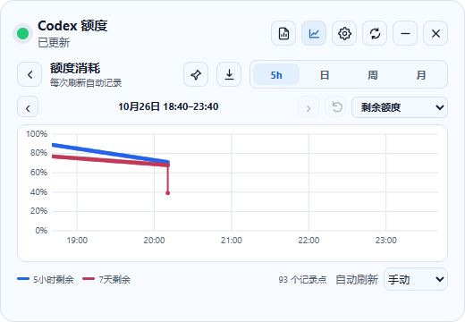
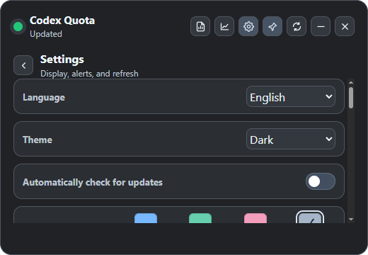
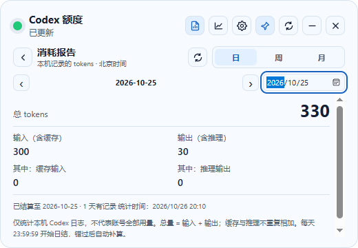

# Codex Floating Ball

[English](README.en.md) | 中文

基于 [codex-led-widget](https://github.com/xicunwus2025-sys/codex-led-widget) 二次开发的 Codex 桌面额度小组件。

## 2.0 轻量化测试版

本分支将 v1.2.2 的功能迁移至 **Tauri + Rust + 系统 WebView**，不再随应用打包 Electron、Chromium 和 Node.js。当前版本为 **2.0.0-beta.1**，不是已完成长期验证的正式版。

- 可拖动悬浮球；单击展开，双击刷新；可独立调整球体和两种文字的大小。
- 五小时／周额度、仅周额度账号、可调周额度告警、倒计时或重置时间点。
- 自动刷新、智能活跃／闲置刷新、概览和曲线页面的刷新间隔同步。
- 5h／日／周／月曲线、历史日期、左键平移、滚轮缩放、自适应刻度、悬停数值、剩余／消耗切换和 CSV 导出。
- 本机 tokens 日／周／月报告，保留旧版去重和汇总算法。北京时间 23:59:59 触发扫描，跨日后补做结算；软件关闭时无法定时运行，下次启动会补扫本地日志。
- 中文／英文、跟随系统的深浅模式、四套配色、默认详情页、曲线独立置顶、托盘和可关闭的更新通知。
- macOS 构建源码包含菜单栏图标、玻璃效果和减少透明度适配；尚待 Mac 实机测试。

## 下载和运行

**推荐下载：[Windows x64 安装版](https://github.com/lambsusie/codex-floating-ball/releases/download/v2.0.0-beta.1/Codex-Floating-Ball-2.0.0-beta.1-win-x64-setup.exe)**。按提示安装；缺少 **Microsoft Edge WebView2 Runtime** 时会联网下载运行时，因此首次安装可能需要网络连接。

已安装 WebView2 的用户可备选使用[单文件运行版](https://github.com/lambsusie/codex-floating-ball/releases/download/v2.0.0-beta.1/Codex-Floating-Ball-2.0.0-beta.1-win-x64.exe)。单文件版不会自行安装 WebView2，也不是把数据保存在 EXE 旁的完全便携模式。

本次只发布 Windows x64，明确标记为 **Pre-release 测试版**，不提供 macOS 或 Linux 安装包。查看[发布说明及 SHA256 校验文件](https://github.com/lambsusie/codex-floating-ball/releases/tag/v2.0.0-beta.1)；需要稳定版时可继续使用 [v1.2.2](https://github.com/lambsusie/codex-floating-ball/releases/tag/v1.2.2)。源码保存在本 beta 分支，稳定版 `main` 不变。

请先安装并登录官方 Codex 客户端，或安装可用的 Codex CLI。

安装包的体积不包含系统共享的 WebView2、Codex 客户端，也不代表运行内存或全部磁盘占用。小组件不会捆绑第二份 Codex CLI。可通过 `CODEX_CLI_PATH` 指定 CLI 路径，通过 `CODEX_HOME` 指定日志根目录。

建议先退出旧版小组件，再启动测试版，避免两个窗口同时采样。本测试版没有自动覆盖旧版程序，也不会自动安装新版本。更新提示只引导到本项目的 GitHub Releases。

## 旧版数据迁移

第一次启动会读取旧版配置和历史，并复制到新版独立目录：

| 平台 | 旧版目录 | 新版目录 |
| --- | --- | --- |
| Windows | `%APPDATA%\codex-floating-ball` | `%APPDATA%\io.github.lambsusie.codexfloatingball.v2` |
| macOS | `~/Library/Application Support/codex-floating-ball` | `~/Library/Application Support/io.github.lambsusie.codexfloatingball.v2` |

迁移包括额度历史、tokens 报告、统计索引、普通配置和 Electron 本地数据库中的界面偏好。读取数据库时操作的是副本，不修改旧目录。迁移状态记录在新版目录的 `migration.json` 中。

两个版本之后的新增记录**不会双向同步**。请保留旧版和备份；不要把用户数据目录、`qa/`、Codex 日志或凭据上传到 GitHub。若提示部分导入失败，保留两边目录并报告问题，不要先清空旧数据。

## 界面预览

以下截图使用模拟数据，不包含真实账号额度或对话。





## 本地构建

需要 Node.js 24、Rust stable，以及对应平台的 Tauri 编译依赖。Windows 还需 Visual Studio C++ Build Tools 和 Windows SDK；macOS 需 Xcode Command Line Tools。

```sh
npm ci
npm test
cargo test --locked --manifest-path src-tauri/Cargo.toml
npm run build
```

macOS：

```sh
npm run build -- --bundles app,dmg
```

`.github/workflows/build-desktop.yml` 可手动构建 Windows x64、Apple 芯片和 Intel Mac 安装包。该工作流只上传 Actions 构建产物，不会发布 Release。

macOS 默认使用临时签名（ad-hoc），**不是 Developer ID 签名或 Apple 公证**。构建步骤会检查签名完整性，但不能据此保证没有 Gatekeeper 提示。遇到恶意软件拦截时，应先检查来源和构建产物，不要关闭系统安全检查。

## 测试和限制

Windows 已验证真实额度读取、旧版数据副本迁移、原算法 tokens 汇总一致性，以及模拟记录下的完整界面交互。具体记录见随测试包提供的验证说明。

macOS 尚未在本机编译或实机运行；跨显示器 DPI 切换、睡眠唤醒、Explorer 真正崩溃恢复、系统通知送达和连续多日运行仍需用户环境回归测试。暂不提供 Linux 发布包。

`reference/` 保留 v1.2.2 的 tokens 算法用于生成和对照测试；运行包只包含提取后的浏览器算法，不包含这些 Node.js 模块或测试资料。

## 致谢

本项目不是完全原创，也不是 OpenAI 官方产品。保留上游项目来源与现有 MIT 许可证，感谢原项目作者及贡献者。
